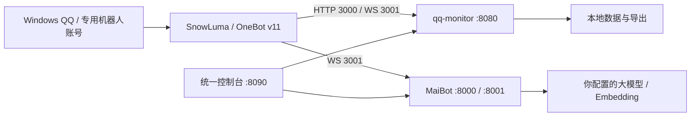

# QQBot Windows Stack

一套 Windows 原生 QQ 机器人源码集成：**群聊记录与审核 + MaiBot AI 聊天 + 统一管理控制台**。

适合希望在自己的 Windows 电脑上管理 QQ 群、查历史消息、接入大模型聊天，并保留本地数据的使用者。它是从实际运行项目整理的源码发布版，包含定制的 MaiBot 源码与插件。QQ 客户端、SnowLuma、Python 运行时和模型服务需要自行准备。

## 能做什么

| 组件 | 用途 |
|---|---|
| `qq-monitor` | 收集指定群的消息、本地保存与检索；关键词规则、可选 AI 审核、违规告警与人工复核；数据导出。默认不自动清理聊天记录。 |
| `panel` | 查看服务状态和日志，管理监控群、发言群、规则、模型/API 与 MaiBot 配置；浏览消息、告警和记忆。 |
| `bot/MaiBotOneKey/modules/MaiBot` | 定制 MaiBot 聊天核心：群聊/私聊、大模型调用、图像理解、记忆与插件。需配置自己的模型与机器人账号。 |
| MaiBot 插件 | SnowLuma OneBot 接入，以及联网搜索、娱乐、语音等可选扩展。外部服务可能另需依赖、密钥或素材。 |

可以只运行监控与控制台。AI 审核、主动发言、语音和娱乐等能力均应在完成对应配置后启用；本仓库不附带作者的聊天记录、人物关系、账号、API 密钥或模型账号登录态。

## 工作方式



## 快速开始（Windows）

### 1. 准备环境

- Windows 10/11，64 位 **Python 3.12**，安装时启用 Python Launcher（`py`）。
- 下载本仓库 ZIP 并解压，或执行：

  ```powershell
  git clone https://github.com/RCRTX/qqbot-windows-stack.git
  cd qqbot-windows-stack
  ```

- 准备 QQ 专用账号和 [SnowLuma](https://github.com/SnowLuma/SnowLuma)，按其[官方文档](https://snowluma.github.io/en/docs/guide/introduction)完成安装、登录和接入。为该账号开放 OneBot v11 **HTTP `127.0.0.1:3000`**、**正向 WebSocket `127.0.0.1:3001`**，设置自己的 access token。
- 只选择需要接入的机器人账号。本发布版启动器不会替你注入、登录或关闭 QQ，也不会安装外部桥接程序。

### 2. 安装依赖并生成配置

在仓库目录打开 PowerShell：

```powershell
py -3.12 -m venv .venv
.\.venv\Scripts\python.exe -m pip install -r requirements.txt
.\.venv\Scripts\python.exe tools/setup.py
```

也可以双击 `setup.bat`。生成器只创建缺失配置，保留已存在的文件。配置文件、数据库、日志、虚拟环境都已加入 `.gitignore`。

### 3. 填写自己的配置

编辑 `qq-monitor/config/config.win.json`：

- OneBot HTTP / WebSocket 地址与 access token，与 SnowLuma 一致。
- 机器人 QQ、需要监控的群号、告警接收人。**初始群列表为空**，需要自行选择。
- 数据/导出路径；默认使用仓库内的本地目录。
- 若要 AI 审核，再配置兼容的 API 地址、密钥、模型名称并启用相关开关。

详细字段及可选功能见 [配置说明](docs/CONFIGURATION.md)。不要把填好的真实配置提交到公开仓库。

### 4. 启动和访问

先让 QQ 与 SnowLuma 的 OneBot 接口正常运行，然后双击 `start.bat`，或执行：

```powershell
.\.venv\Scripts\python.exe tools/stack.py start
.\.venv\Scripts\python.exe tools/stack.py status
```

- 统一控制台：<http://127.0.0.1:8090>
- 监控面板：<http://127.0.0.1:8080>
- 停止本仓库启动的服务：双击 `stop.bat` 或 `python tools/stack.py stop`。

默认启动监控与控制台。启动器会检查端口占用，避免把别的实例当成本实例；不会按 QQ 进程名执行结束操作。请从资源管理器双击启动，避免在生命周期受限的 AI 终端里托管长期服务。

### 5. 可选：启用 MaiBot 聊天

```powershell
.\.venv\Scripts\python.exe -m pip install -r bot/MaiBotOneKey/modules/MaiBot/requirements.txt
.\.venv\Scripts\python.exe tools/setup.py --with-bot
```

按照 [MaiBot 源码说明](bot/MaiBotOneKey/README.md)生成/编辑机器人配置与模型配置，设置自己的回复、决策、识图和 embedding 模型；将 `snowluma-adapter` 插件的连接地址、令牌和账号与 SnowLuma 对齐。模型名以你实际 API 提供商支持的名称为准。

完成后运行：

```powershell
.\.venv\Scripts\python.exe tools/stack.py start --with-bot
```

这是源码分发版，未附带原一键包的便携运行时与作者的模型路由。启用聊天前还需接受/确认上游 MaiBot 要求的配置与条款；插件额外依赖按对应说明安装。

## 常见问题

- **端口被占用**：先用 `tools/stack.py status` 查看。不要同时启动另一套使用 3000/3001/8000/8001/8080/8090 的机器人栈。
- **QQ 重启后不回话**：先到 SnowLuma 确认专用机器人账号仍已接入。再查看 MaiBot 日志是否出现 OneBot WebSocket 连接成功。仅端口能连通不代表消息已发到 QQ。
- **监控群为空**：初次安装不会自动订阅作者的群。请在监控配置或控制台里填写自己的群号并重启对应服务。
- **模型报 401/402/429**：检查自己的密钥、余额、模型权限与限流；聊天、审核、记忆 embedding 是不同调用，某一项正常不代表其他项也正常。
- **本机 API 连接失败**：本地请求应直连。启动器会向已有 `NO_PROXY/no_proxy` 追加 `127.0.0.1,localhost,::1`。
- **面板里某项功能缺素材/外部服务**：仓库未提供私有图片、语音模型、浏览器 Cookie 或商业服务密钥；按插件说明准备，或保留关闭状态。

更多信息见 [运行与排障](docs/OPERATIONS.md)、[发布范围与验证](docs/RELEASE.md)。

## 源码与许可证

本项目包含定制的 [MaiBot](https://github.com/MaiM-with-u/MaiBot) 与 [MaiBotOneKey](https://github.com/DrSmoothl/MaiBotOneKey) 源码，保留各自 GPL-3.0 许可证与署名。集成及新增代码以 GPL-3.0 发布。Dashboard 等子目录另有 AGPL-3.0 声明；A_memorix 同时保留原许可及 MaiBot 特别授权，不能将全部文件视为同一许可。详情见 [第三方说明](THIRD_PARTY_NOTICES.md) 和 [LICENSE](LICENSE)。

QQ、SnowLuma、Python 与模型服务是独立外部依赖，不打包其二进制、登录态或服务授权。使用时遵守各服务条款，仅处理你有权处理的群聊数据。管理面板具有配置与服务控制能力，默认仅在本机访问，不要直接暴露到公网。
